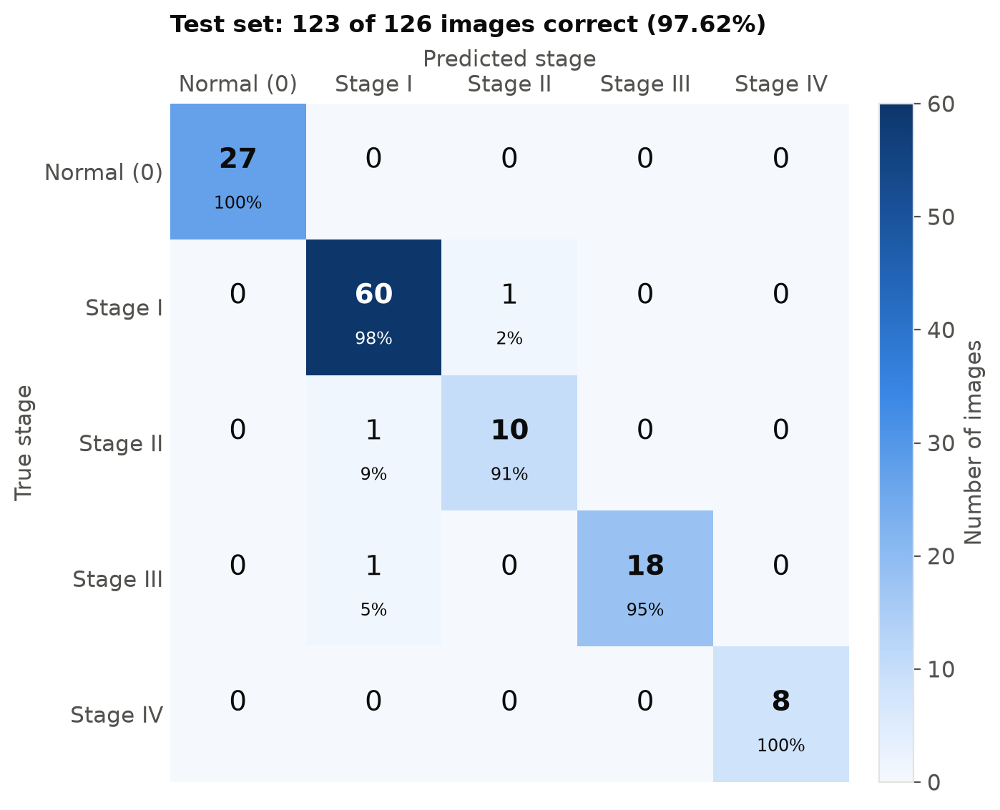
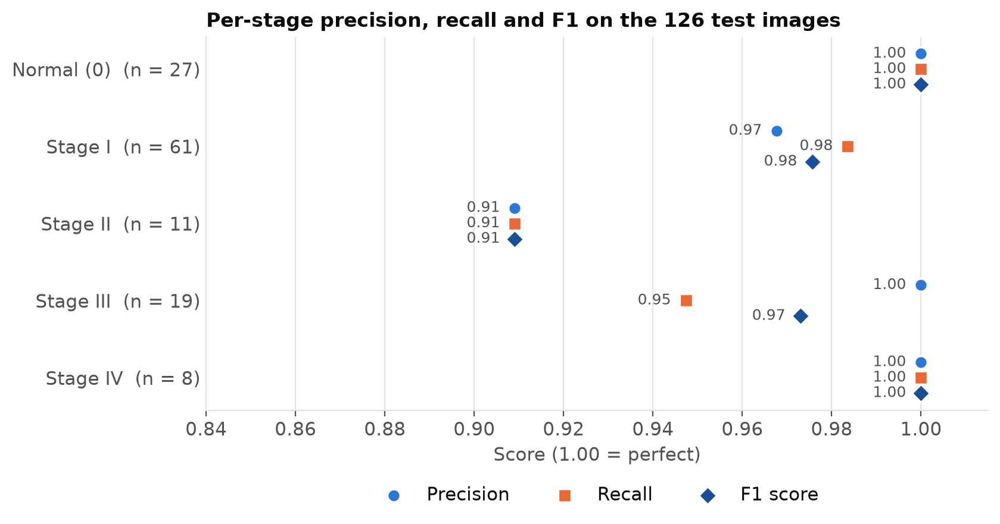
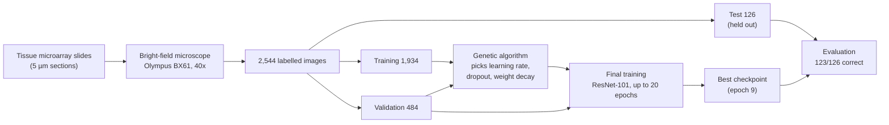
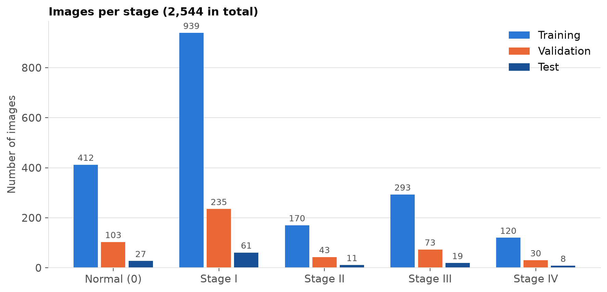
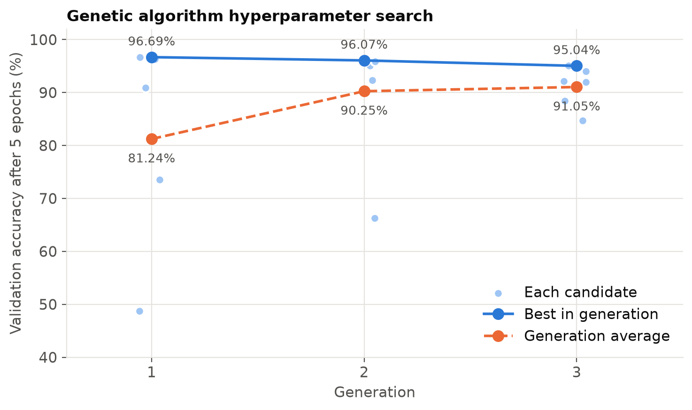
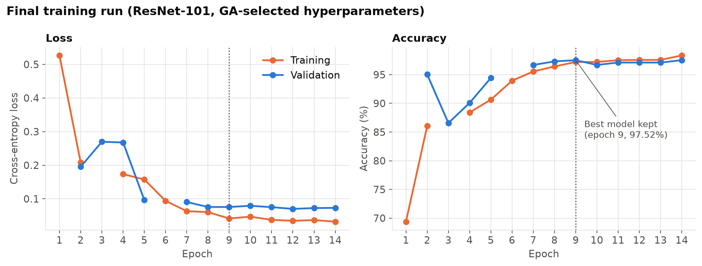

# Ovarian cancer stage classification from bright-field microscopy images

This repository holds the code, trained-model instructions and results for:

> A. K. Mishra, M. Alrubayan, M. Alizadeh Poshtiri and P. Pradhan, *Deep learning–based stage classification of ovarian cancer using bright-field microscopy images of histopathological tissue sections.* Department of Physics and Astronomy, Mississippi State University. 

A ResNet-101 neural network looks at a single microscope image of a thin ovarian tissue section. It sorts the image into one of five classes: normal tissue, or cancer stage I, II, III or IV. On 126 test images the model had never seen, it was right 123 times (97.62%).

## Contents

1. [The study in plain terms](#the-study-in-plain-terms)
2. [Results](#results)
3. [How the method works](#how-the-method-works)
4. [What is in this repository](#what-is-in-this-repository)
5. [Running the code](#running-the-code)
6. [Data availability](#data-availability)
7. [Notes on reproducibility](#notes-on-reproducibility)
8. [Software used](#software-used)
9. [Funding](#funding)

## The study in plain terms

**The problem.** The stage of ovarian cancer (I to IV, under the FIGO system) is the strongest predictor of how a patient will do, and it decides the first treatment. Part of staging is a pathologist looking at tissue under a microscope. That work takes time, and two pathologists do not always agree on the same slide.

**What we did.** We photographed thin (5 µm) slices of ovarian tissue under an ordinary bright-field microscope at 40x magnification. Each image was already labelled as normal tissue or as stage I, II, III or IV. We then trained a computer model to recognise the stage from the image alone:

- The model starts from ResNet-101, a published image-recognition network that had already learned general visual features from 1.2 million everyday photographs (ImageNet). We retrained it on our tissue images. This is called *transfer learning*.
- Training a network involves settings that have to be chosen in advance, for example how fast it learns. Instead of guessing them, we used a *genetic algorithm*: it tries several combinations, keeps the better ones, mixes them, and repeats. This works like natural selection applied to settings.
- Some stages had far more images than others (1,235 for stage I but only 158 for stage IV). The training procedure gives the rare stages extra weight so the model does not ignore them.

**What we found.** On 126 test images that were kept aside and never used during training or tuning, the model classified 123 correctly. Every normal-tissue and stage IV image was classified correctly. All three mistakes confused neighbouring early stages (I, II and III), which pathologists also find hardest to tell apart.

**What this does not show yet.** These results come from one laboratory, one microscope and one set of tissue microarray slides. The training and test images were split by image, not by patient, so the test does not prove the model works on new patients. It has to be tested on larger datasets from several hospitals, with patients kept separate between training and testing, before anyone could think about clinical use. It is meant to support a pathologist, not replace one.

## Results

All numbers below come from [`results/test_results.txt`](results/test_results.txt), which [`code/evaluate.py`](code/evaluate.py) produces from the trained model.

| Class | Test images | Precision | Recall | F1 score |
|---|---:|---:|---:|---:|
| Normal (0) | 27 | 1.00 | 1.00 | 1.00 |
| Stage I | 61 | 0.97 | 0.98 | 0.98 |
| Stage II | 11 | 0.91 | 0.91 | 0.91 |
| Stage III | 19 | 1.00 | 0.95 | 0.97 |
| Stage IV | 8 | 1.00 | 1.00 | 1.00 |
| **All (accuracy)** | **126** | | | **97.62% (123/126)** |

*Precision:* of the images the model called stage X, the share that really were stage X. *Recall:* of the images that really were stage X, the share the model found. *F1:* a single score that combines the two.

The confusion matrix shows every test prediction. Each row is the true class, each column is the model's answer, and the diagonal holds the correct answers.



The three errors: one stage I image predicted as stage II, one stage II image predicted as stage I, and one stage III image predicted as stage I.



## How the method works



### Images and data split

Ovarian tissue microarray slides were obtained from Biomax.us. Each slide holds 24 tissue cores, 1.5 mm across and 5 µm thick. Images were taken in transmission mode on an Olympus BX61 microscope with a 40x objective and an AmScope camera. OptiScan software (Prior Scientific) moved the stage and triggered the camera, at about 3.6 seconds per image.

The development set has 2,418 images. [`code/train.py`](code/train.py) splits it 80/20 into training and validation sets, stratified by class with a fixed random seed (42). A separate set of 126 images was held back for the final test and was not used for training or for choosing hyperparameters.



Labels: 0 = normal/benign control, 1 = stage I, 2 = stage II, 3 = stage III, 4 = stage IV.

### Preprocessing and augmentation

Every image is resized to 224 x 224 pixels and normalised with the ImageNet channel means (0.485, 0.456, 0.406) and standard deviations (0.229, 0.224, 0.225). Training images also get random changes each time they are shown to the model, so it does not memorise exact pixels:

- horizontal and vertical flips (probability 0.5 each)
- rotation up to ±15°
- brightness, contrast and saturation jitter of 0.1
- affine scaling from 0.8 to 1.2 and shear up to 10°

Validation and test images are only resized and normalised.

### Model

ResNet-101 with ImageNet weights (`torchvision` `IMAGENET1K_V1`). Its last layer is replaced by a dropout layer followed by a linear layer with 5 outputs, one per class. All layers are trained.

### Class imbalance

Two measures, both using weights inversely proportional to each class's image count in the training set:

1. A `WeightedRandomSampler` draws rare-class images more often.
2. The cross-entropy loss gives errors on rare classes more weight.

### Hyperparameter search with a genetic algorithm

| Setting | Search range | Selected value |
|---|---|---|
| Learning rate | 1e-5 to 1e-3 | 2.0027e-4 |
| Dropout rate | 0.3 to 0.7 | 0.3032 |
| Weight decay | 1e-6 to 1e-4 | 3.7242e-5 |

The search runs 3 generations, starting from 5 random candidates. Each candidate is scored by training for 5 epochs and measuring validation accuracy. Parents are chosen by tournament selection (3 contestants), children are made by blend crossover, and Gaussian mutation is applied with probability 0.1. The full-precision selected values are in [`code/common.py`](code/common.py).



### Final training

The final model is trained with the Adam optimiser and the selected hyperparameters, with a batch size of 32, for at most 20 epochs. The learning rate drops by a factor of 10 if validation accuracy does not improve for 2 epochs. Training stops after 5 epochs without improvement. The weights from the epoch with the best validation accuracy are kept.

In the original run, validation accuracy peaked at 97.52% at epoch 9. Training stopped at epoch 14, after 5 epochs without improvement, and the epoch 9 weights were kept.



Gaps in the lines are epochs whose values were not captured in the saved console log (see [Notes on reproducibility](#notes-on-reproducibility)).

### Evaluation

[`code/evaluate.py`](code/evaluate.py) runs the kept model on the 126 test images and computes accuracy, per-class precision, recall and F1 score, and the confusion matrix with `scikit-learn`.

## What is in this repository

```
ovarian-cancer-staging/
├── README.md                  this page
├── requirements.txt           Python packages needed
├── code/
│   ├── train.py               genetic algorithm search + final training
│   ├── evaluate.py            test-set evaluation of a trained model
│   ├── common.py              dataset, image transforms, model definition, selected hyperparameters
│   ├── make_label_csv.py      builds the label CSV files from the image filenames
│   └── figures/               one script per figure in figures/
├── data/
│   └── README.md              how to request the data and where to put it (no data is stored here)
├── model/
│   └── README.md              how to download the trained weights
├── results/
│   ├── test_results.txt       accuracy, per-class metrics, confusion matrix
│   ├── confusion_matrix.csv
│   ├── dataset_split.csv      image counts per class and split
│   ├── original_training_log.txt            console output of the original run
│   ├── original_ga_search_history.csv       every GA candidate's score, from that log
│   ├── original_final_training_history.csv  per-epoch metrics, from that log
│   └── README.md
└── figures/                   every figure shown on this page
```

## Running the code 

You need Python 3 (tested with Python 3.14 on macOS). A GPU makes training practical; evaluation of the 126 test images took 45 seconds on an Apple-silicon laptop.

**1. Install the packages** (inside a virtual environment if you prefer):

```bash
pip install -r requirements.txt
```

**2. Get the data and the trained model.** The images are available on request (see [Data availability](#data-availability)); place them and create the label files as described in [`data/README.md`](data/README.md). Download `best_ovarian_model.pth` (163 MB) from this repository's [Releases page](../../releases) into `model/`.

**3. Reproduce the test results:**

```bash
python code/evaluate.py
```

Expected output: `Accuracy: 97.62% (123/126 correct)`, followed by the per-class table and confusion matrix above.

**4. Retrain the model (optional).** The original full run took about 7 hours (around 4 to 5 minutes per training epoch), most of it in the genetic algorithm search:

```bash
python code/train.py
```

To skip the search and train once with the hyperparameters reported above:

```bash
python code/train.py --skip-ga
```

New runs are written to `runs/latest/`, so they never overwrite the published model. Retraining will not give exactly the same weights, because the random sampling, augmentation and GPU arithmetic differ between runs and machines. Run `python code/train.py --help` for all options.

**5. Redraw the figures:**

```bash
python code/figures/plot_confusion_matrix.py
```

Each script in `code/figures/` writes one file to `figures/`. `plot_dataset_split.py` needs the label files in `data/`; the others read only from `results/`.

## Data availability

The microscopy images are not included in this repository. They are available from the corresponding author, Dr. Prabhakar Pradhan (Department of Physics and Astronomy, Mississippi State University), on reasonable request. No images, image lists or per-image labels are stored in this repository; it contains only code, the trained-model instructions and summary results.

## Notes on reproducibility

The published model was trained with an earlier, single-file version of `train.py`. This repository's code is a cleaned-up version of it. The data split, preprocessing, augmentation, model, loss, optimiser, learning-rate schedule and early stopping are unchanged. Running `evaluate.py` on the published weights reproduces the paper's test results exactly.

Things that differ from the original script, and why:

- **Genetic algorithm bookkeeping.** In the original script, the population grew from 5 to 6 candidates after the first generation (visible in the log as "Evaluating individual 6/5"). Its final step also chose the winner by matching the new, unevaluated candidates against the previous generation's scores. The code here keeps the population at 5 and returns the best candidate it actually evaluated, which is the procedure described in the paper. The published model used the hyperparameters printed by the original run, which are stored in `code/common.py` and used by `--skip-ga`.
- **Seeding.** The original script did not set a random seed; this one sets it to 42 by default.
- **Library updates.** `pretrained=True` became `weights=IMAGENET1K_V1`, which loads the same ImageNet weights under current `torchvision`. Apple-silicon GPUs (MPS) are used when available.

About the training figures: the original run printed its progress to the console and the metrics were not saved to a file. [`results/original_training_log.txt`](results/original_training_log.txt) is that console output as it was copied at the time. It contains some repeated lines, and a few values were not captured (validation metrics for epochs 1 and 6, and training metrics for epoch 3). The CSV files in `results/` were transcribed from this log, and the figures are drawn from those CSVs. The current `train.py` writes `training_history.csv` and `ga_search_history.csv` directly.

## Software used

| Purpose | Software |
|---|---|
| Image acquisition | OptiScan (Prior Scientific), controlling the Olympus BX61 stage and AmScope camera |
| Language | [Python](https://www.python.org/) |
| Deep learning | [PyTorch](https://pytorch.org/) and [torchvision](https://pytorch.org/vision/) (ResNet-101, transforms, ImageNet weights) |
| Metrics and data split | [scikit-learn](https://scikit-learn.org/) |
| Tables and arrays | [pandas](https://pandas.pydata.org/), [NumPy](https://numpy.org/) |
| Image loading | [Pillow](https://python-pillow.org/) |
| Figures | [Matplotlib](https://matplotlib.org/) |
| Progress bars | [tqdm](https://tqdm.github.io/) |

The code in this repository was last tested with Python 3.14, PyTorch 2.15, torchvision 0.29, scikit-learn 1.9, pandas 3.1 and Matplotlib 3.11.

## Funding

This work was supported by the National Cancer Institute of the National Institutes of Health under grant R21CA260147, and by the Office of Research and Economic Development at Mississippi State University.
